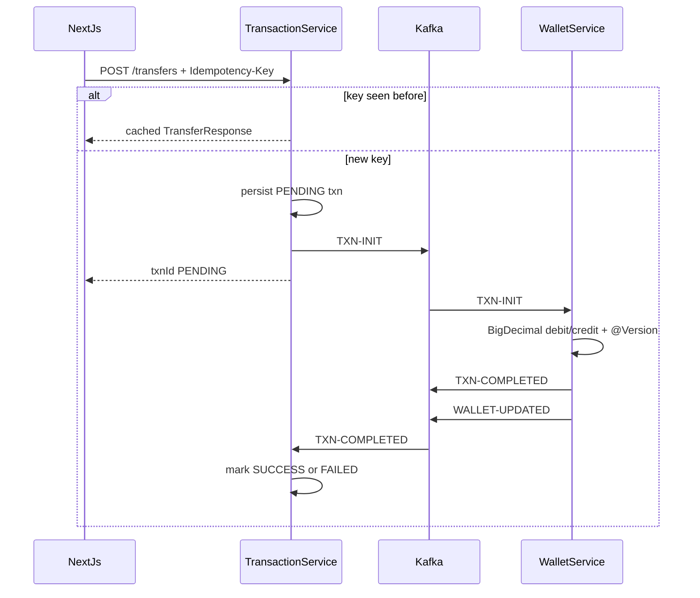
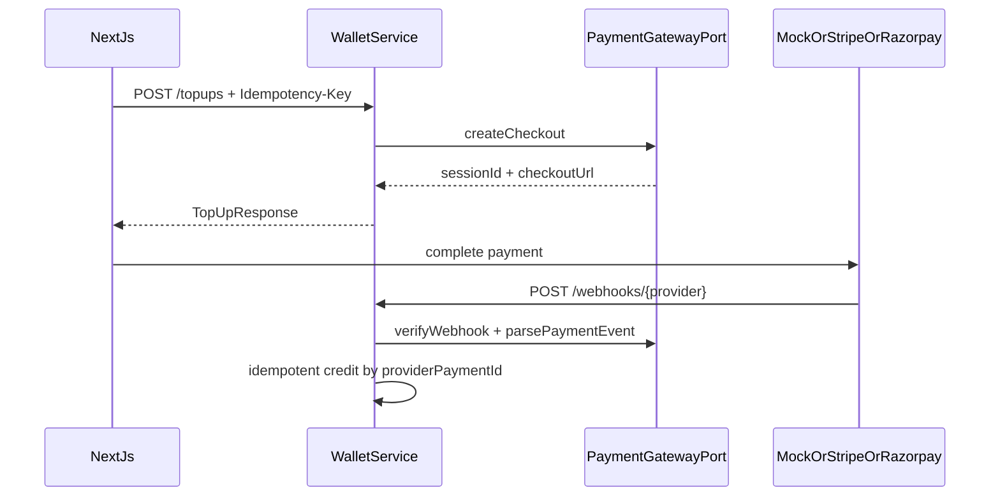

# Architecture

## System context

AshuBoi Wallet is an event-driven wallet platform. The UI never talks to Kafka or MySQL directly. Nginx routes HTTP to Spring Boot services. Money movement is split into:

1. **P2P transfers** — initiated by transaction-service, settled by wallet-service over Kafka.
2. **Top-ups** — initiated against a `PaymentGatewayPort`, credited only after a verified provider event.

## P2P transfer sequence



## Top-up sequence (provider-agnostic)



## Idempotency model

Table `idempotency_record` (per service DB):

| Column | Purpose |
| --- | --- |
| `scope` | `P2P_TRANSFER`, `TOPUP_CHECKOUT`, `TOPUP_CREDIT` |
| `idempotencyKey` | Client key or `provider:paymentId` |
| `requestHash` | SHA-256 of canonical request body |
| `responseBody` | Cached JSON response |

Conflict rule: key reuse with a different hash → HTTP 409.

Webhook natural key: `{provider}:{providerPaymentId}` so provider retries never double-credit.

## Payment port

```text
PaymentGatewayPort
  ├─ MockPaymentGateway      (demo default)
  ├─ StripePaymentGatewayStub
  └─ RazorpayPaymentGatewayStub
```

Switch with `payment.provider=mock|stripe|razorpay`. Only mock is fully implemented for the free portfolio demo; stubs document the extension point.

## Security boundaries

- JWT issued by user-service (`/auth/register`, `/auth/login`).
- JwtAuthFilter on services validates Bearer tokens.
- Transfer `fromUserId` is taken from the token, never from the request body.
- Public paths: auth, swagger, health, mock-pg, webhooks.
